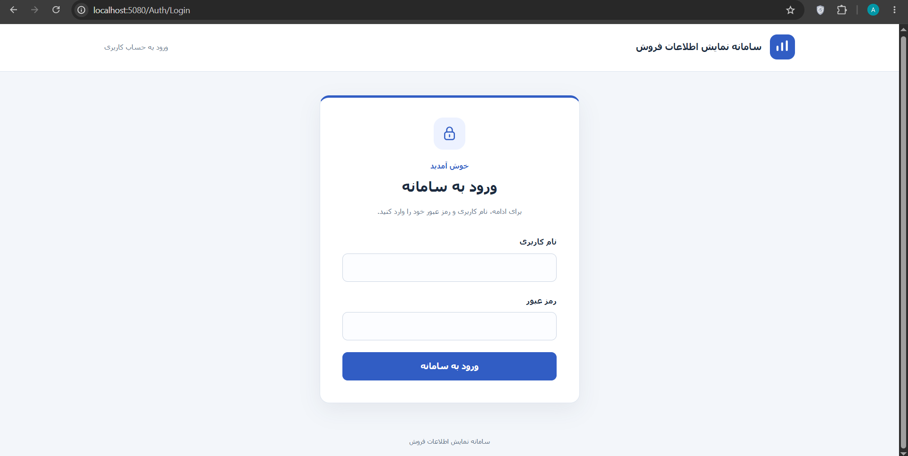
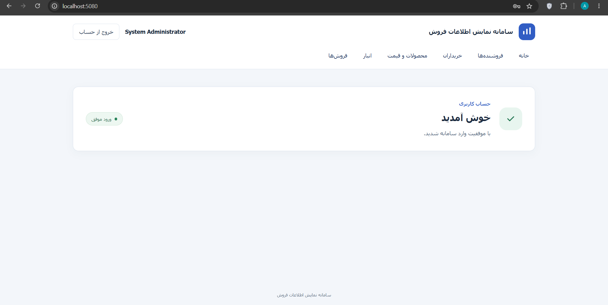
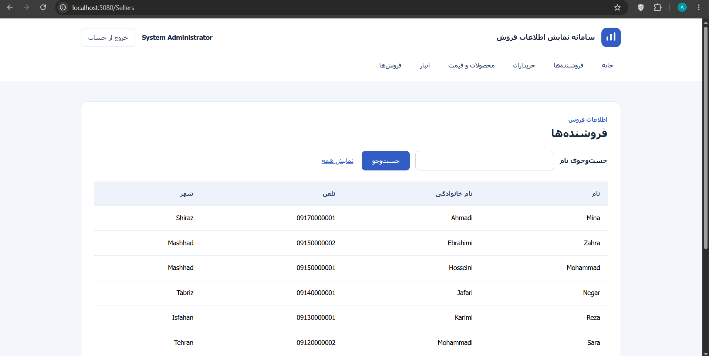
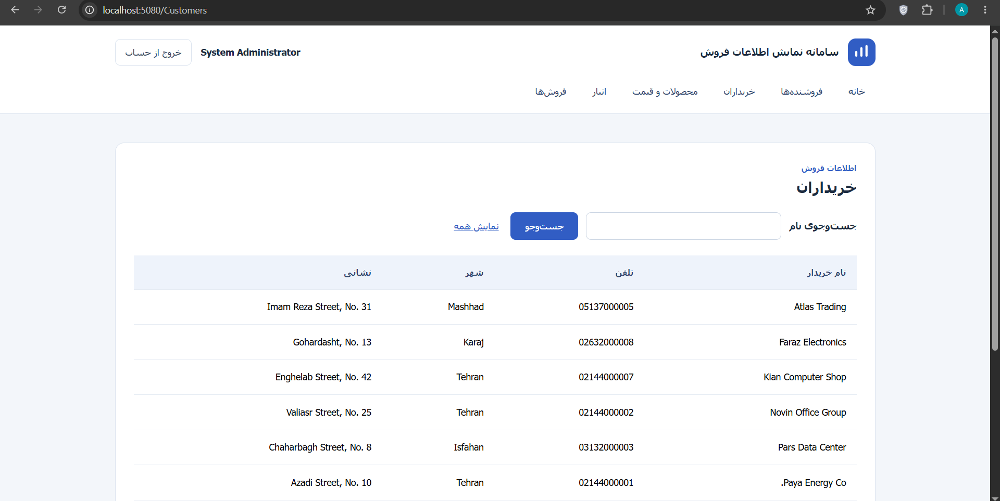
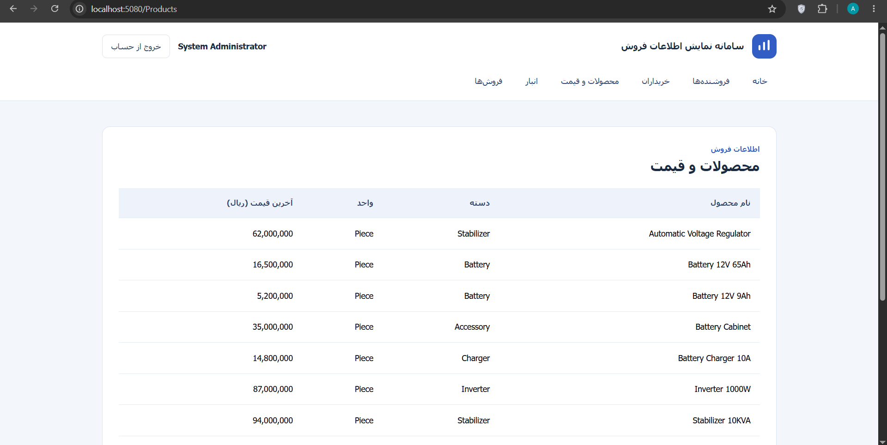
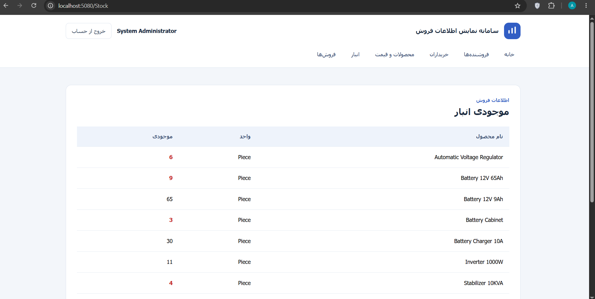
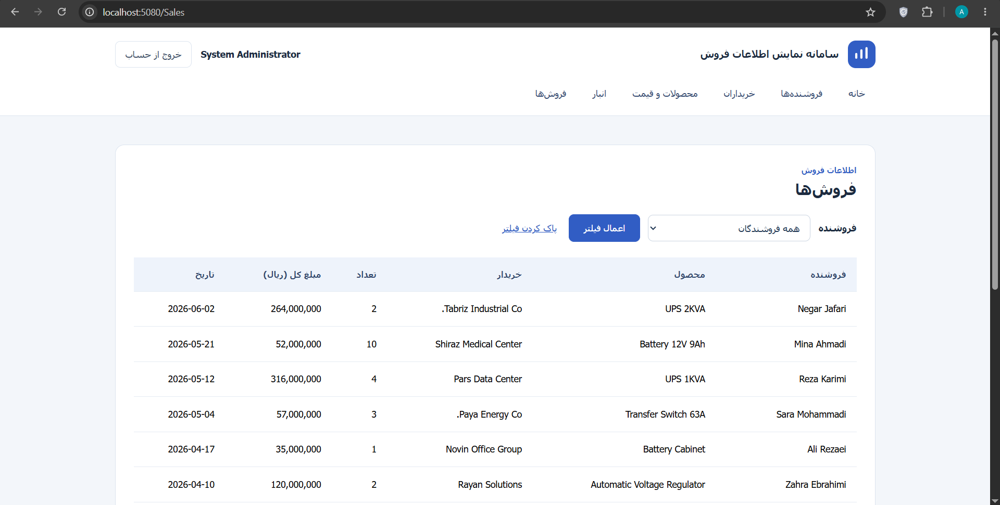

<div dir="rtl">

# سامانه نمایش اطلاعات فروش

پروژهٔ دانشجویی SalesDashboard مطابق RFP، برای ورود کاربر و مشاهدهٔ فقط‌خواندنی فروشندگان، خریداران، محصولات و قیمت، موجودی انبار و فروش‌ها ساخته شده است. جست‌وجوی نام فروشنده و خریدار و فیلتر فروش‌ها بر اساس فروشنده در دسترس است.

## فناوری و ساختار

- ASP.NET Core MVC و Razor با هدف `net10.0`
- EF Core و SQL Server
- رابط فارسی راست‌به‌چپ و Bootstrap محلی
- آزمون‌های xUnit و WebApplicationFactory

| مسیر | مسئولیت |
|---|---|
| `src/SalesDashboard.Web` | Controller، View، ViewModel و تنظیمات برنامه |
| `src/SalesDashboard.Business` | Service، قراردادها، مدل‌ها و DTO |
| `src/SalesDashboard.Data` | Repository، نگاشت EF و ثبت دسترسی داده |
| `database/Scripts` | ساخت دیتابیس‌ها، دادهٔ نمونه و Viewها |
| `src/tests/SalesDashboard.Tests` | آزمون‌های سه دور |
| `docs` | نیازمندی‌ها، طراحی، تست، نمودارها و DevLog |

برنامه فقط یک Connection String و یک DbContext متصل به **WebAppDB** دارد. جدول `Users` و پنج View در این دیتابیس قرار دارند. Viewها با نام سه‌بخشی از جدول‌های **SalesDB** می‌خوانند؛ برنامه مستقیماً به SalesDB متصل نمی‌شود و داده‌های کسب‌وکار را کپی نمی‌کند.

Controllerها Service را صدا می‌زنند. قرارداد Repository در Business و پیاده‌سازی آن در Data است. ارجاع Web به Data برای ثبت DI در `Program.cs` است.

## پیش‌نیازها

- SDK نسخهٔ .NET 10 سازگار با هدف پروژه
- SQL Server و دسترسی ایجاد دو دیتابیس در محیط آزمایشی
- SSMS یا ابزار اجرای اسکریپت SQL
- دسترسی NuGet برای نخستین Restore

## آماده‌سازی پایگاه داده

برای **محیط تازه** فایل‌های زیر را به همین ترتیب در SSMS اجرا کنید:

1. `database/Scripts/SalesDB_Create.sql`
2. `database/Scripts/SalesDB_Data.sql`
3. `database/Scripts/WebAppDB_Create.sql`

هر دو دیتابیس باید روی همان نمونهٔ SQL Server باشند. اسکریپت‌ها را با حسابی اجرا کنید که اشیای آن در schema `dbo` ایجاد شوند. حساب مورد استفادهٔ برنامه باید بتواند `Users` و پنج View را در WebAppDB بخواند و دسترسی بین دیتابیس‌ها برای Viewها برقرار باشد.

اسکریپت‌های ساخت و Seed برای اجرای مجدد روی دیتابیس موجود طراحی نشده‌اند؛ اگر دیتابیس‌ها از قبل آماده‌اند، دوباره اجرا نکنید.

## تنظیم اتصال

کلید اتصال در `src/SalesDashboard.Web/appsettings.json` برابر `ConnectionStrings:WebAppDB` است. تنظیم نمونه از Windows Integrated Security و SQL Server محلی استفاده می‌کند. نام Server را با نمونهٔ نصب‌شدهٔ خود تطبیق دهید؛ نام Database باید **WebAppDB** باقی بماند.

برای تغییر اتصال فقط در همان نشست PowerShell، بدون ذخیرهٔ تنظیم شخصی در ریپو:

```powershell
$env:ConnectionStrings__WebAppDB = 'Server=localhost;Database=WebAppDB;Integrated Security=True;TrustServerCertificate=True'
```

احراز هویت SQL Server را مطابق محیط خود تنظیم کنید. 

## اجرای برنامه

در پوشه‌ای که `SalesDashboard.sln` قرار دارد:

```powershell
dotnet restore SalesDashboard.sln
dotnet build SalesDashboard.sln -m:1
dotnet run --project src/SalesDashboard.Web/SalesDashboard.Web.csproj
```

آدرس localhost را از پیام `Now listening on` بردارید و در مرورگر باز کنید. برای توقف برنامه `Ctrl+C` بزنید.

## حساب‌های آزمایشی

| نام کاربری | رمز | وضعیت |
|---|---|---|
| `admin` | `Demo@123` | فعال |
| `user01` تا `user08` | `Demo@123` | فعال |
| `inactive` | `Demo@123` | غیرفعال؛ ورود باید رد شود |

این حساب‌ها مربوط به Seed آموزشی‌اند. پروژه طبق دامنهٔ RFP رمز را مستقیم مقایسه می‌کند و مدیریت حساب، نقش، هش رمز و قفل حساب ندارد.

## صفحات و رفتارها

| مسیر | رفتار |
|---|---|
| `/Auth/Login` | ورود با نام کاربری و رمز |
| `/Home/Index` | مقصد پیش‌فرض و تأیید ورود |
| `/Sellers` | فروشندگان و جست‌وجوی نام |
| `/Customers` | خریداران و جست‌وجوی نام |
| `/Products` | محصول و آخرین قیمت مؤثر |
| `/Stock` | موجودی؛ مقدار کمتر از ۱۰ قرمز است |
| `/Sales` | فروش‌ها و فیلتر شناسهٔ فروشنده |

نام کامل کاربر و دکمهٔ خروج در سربرگ نمایش داده می‌شوند. خروج با فرم POST انجام می‌شود. صفحات اطلاعاتی بدون ورود در دسترس نیستند.

- جست‌وجوی نام: `Trim` و جست‌وجوی بخشی از متن؛ عبارت خالی همهٔ موارد را نشان می‌دهد.
- آخرین قیمت: آخرین `StartDate` غیرآینده؛ در تساوی تاریخ، بیشترین `PriceId`. محصول بدون قیمت با «ثبت نشده» باقی می‌ماند.
- موجودی ۱۰ قرمز نیست؛ موجودی از `Products.StockQuantity` خوانده می‌شود.
- مبلغ کل فروش از `Quantity × UnitPrice` همان رکورد فروش در View محاسبه می‌شود.
- فیلتر فروشندهٔ خالی یعنی همه؛ شناسهٔ نامعتبر پاسخ ۴۰۰ دارد.
- فهرست خالی با «موردی یافت نشد.» و خطای فنی با پاسخ عمومی ۵۰۳ مشخص می‌شود.
- مبالغ به ریال و تاریخ فروش به صورت میلادی `yyyy-MM-dd` نمایش داده می‌شوند.

## اجرای تست‌ها

```powershell
dotnet test SalesDashboard.sln -m:1 --logger "trx;LogFileName=final-verification.trx" --results-directory TestResults
```

مجموعهٔ فعلی شامل **۳۰ تست** است: ۸ تست ورود و خروج، ۱۱ تست کاتالوگ و ۱۱ تست انبار و فروش. نتیجهٔ بازبینی نهایی: ۳۰ موفق، صفر ناموفق و صفر ردشده. جزئیات انتظار و نتیجه در سند تست آمده است.


## مستندات

اسناد نهایی SRS، طراحی و تست در `docs` قرار می‌گیرند. مدل قابل ویرایش Visual Paradigm در `docs/Diagrams/SalesDashboard_Designs.vpp` و تصاویر نمودارها در همان پوشه نگهداری می‌شوند. روند کار شامل سه دور سناریو، فعالیت، توالی، کلاس، کد و تست بوده است.

## اسکرین‌شات صفحات

### صفحه ورود

### صفحه خانه پس از ورود

### صفحه فروشندگان

### صفحه خریداران

### صفحه محصولات و قیمت

### صفحه انبار

### صفحه فروش‌ها


</div>
